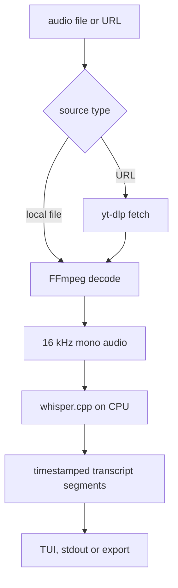

<h1 align="center">scribe</h1>

<p align="center">
  <strong>private speech-to-text, right in your terminal.</strong>
  <br>
  local inference · cpu-only · word-level timing · five export formats
</p>

<p align="center">
  
</p>

<p align="center">
  
  
  
  
  
  <a href="https://crates.io/crates/scribe-tui"></a>
  <a href="https://aur.archlinux.org/packages/scribe-tui-bin"></a>
  
</p>

<p align="center">
  <a href="#install">install</a> ·
  <a href="#quick-start">quick start</a> ·
  <a href="#features">features</a> ·
  <a href="#keybindings">keybindings</a> ·
  <a href="#models">models</a> ·
  <a href="#privacy">privacy</a> ·
  <a href="#sponsor">sponsor</a>
</p>

<p align="center">
  <a href="https://github.com/programmersd21/scribe/releases/latest">releases</a> ·
  <a href="https://crates.io/crates/scribe-tui">crates.io</a> ·
  <a href="https://aur.archlinux.org/packages/scribe-tui-bin">arch user repository</a>
</p>

---

scribe turns audio into timestamped text without sending recordings to a hosted transcription service. give it a local file or a supported URL, watch transcript segments arrive, then search, copy and export from a terminal interface.

no account. no GPU. no subscription. no telemetry.

## why scribe

- **private by design.** inference runs locally through whisper.cpp.
- **no GPU requirement.** CPU-only builds keep installation straightforward.
- **built for terminal use.** a responsive Ratatui interface, keyboard-first controls and 22 themes.
- **useful output.** export subtitles, notes or structured JSON with timestamps.
- **scriptable.** `--no-tui` writes the transcript to stdout.


## sponsor

<p align="center">
  <strong>help keep scribe independent.</strong>
  <br>
  if scribe makes your workflow a little better, consider supporting its continued development.
  <br>
  your support helps make room for maintenance, testing, better documentation and thoughtful improvements.
</p>

<p align="center">
  <a href="https://github.com/sponsors/programmersd21">
    
  </a>
</p>

<p align="center">
  sponsorship is completely optional. using scribe, sharing it, reporting bugs and contributing code are just as appreciated.
</p>

## install

### cargo

requires Rust 1.90 or later, plus the native build prerequisites below.

```sh
cargo install scribe-tui
```

the package is called `scribe-tui` because the `scribe` crate name was already taken. the installed executable is `scribe`.

### arch linux

```sh
paru -S scribe-tui-bin
```

### prebuilt binaries

download the latest release:

**[get the latest release](https://github.com/programmersd21/scribe/releases/latest)**

| platform | release asset |
|:--|:--|
| linux x86_64 | `scribe-linux-x86_64` |
| macOS arm64 | `scribe-macos-aarch64` |
| windows x86_64 | `scribe-windows-x86_64.exe` |

each release includes `SHA256SUMS` for verifying downloaded binaries.

### build prerequisites

| requirement | when it is needed |
|:--|:--|
| Rust 1.90 or later | building from source |
| C/C++ compiler, CMake and libclang | compiling whisper-rs |
| FFmpeg | decoding local audio and video |
| network access | first model download and URL input |

Debian / Ubuntu:

```sh
sudo apt-get install clang libclang-dev cmake pkg-config ffmpeg
```

macOS requires Xcode command line tools and CMake. Windows requires the MSVC build tools and CMake.

for URL input, scribe can download and manage its own yt-dlp and FFmpeg binaries in its cache. local files use FFmpeg available on your system.

## quick start

launch the interface:

```sh
scribe
```

or pass a source directly:

```sh
scribe meeting.wav
scribe https://youtu.be/...
```

choose a model, set a language if you know it, and start transcription.

### useful commands

```sh
scribe lecture.wav --model small-q5_1 --lang en
scribe interview.mp4 --format srt
scribe recording.wav --format md --out ./notes
scribe https://youtu.be/... --format vtt
scribe lecture.wav --no-tui > lecture.txt
scribe --doctor
```

### command-line reference

| option | purpose |
|:--|:--|
| `--model <name-or-path>` | choose a catalog model or local model file |
| `--threads <n>` | set CPU thread count; default is up to 8 |
| `--lang <code>` | set a language hint; use `auto` for detection |
| `--translate` | translate recognized speech to English |
| `--out <dir>` | choose the export directory |
| `--format <fmt>` | choose `txt`, `srt`, `vtt`, `md` or `json` |
| `--theme <name>` | choose the startup theme |
| `--no-tui` | run without the terminal interface and print text to stdout |
| `--doctor` | run a read-only installation check |
| `--help` | show all options |
| `--version` | print the installed version |

`--no-tui` is useful in shell scripts and pipelines. transcript text goes to stdout; diagnostics go to stderr.

```sh
scribe meeting.wav --no-tui > meeting.txt
scribe meeting.wav --no-tui --format json > meeting.json
```

## how it works



URL fetching is an input step. transcription itself happens on your machine.

## features

| capability | details |
|:--|:--|
| live transcription | transcript segments arrive while audio is processed |
| word timing | retain Whisper token timing when available |
| local inference | whisper.cpp through whisper-rs, CPU-only |
| file and URL input | local audio/video or supported URLs |
| model manager | browse, download, pause, resume and remove cached models |
| pause and resume | pause between decode windows and continue from the last committed position |
| partial results | stop a job and keep the transcript already captured |
| five export formats | TXT, SRT, VTT, Markdown and JSON |
| 22 themes | preview and switch palettes at runtime |
| transcript search | find text and navigate between matches |
| path completion | fuzzy-ranked suggestions in the source field |
| diagnostics | inspect dependencies, model integrity, paths and permissions |
| script mode | send plain transcript output to stdout |

## keybindings

### main interface

| key | action |
|:--|:--|
| `enter` | start, confirm, accept a completion or resume |
| `tab` | switch focus or complete a path |
| `up` / `down` | move through selections and suggestions |
| `right` | accept the highlighted completion |
| `ctrl+space` | open the completion list |
| `esc` / `space` / `p` | pause an active job |
| `c` | stop the active job and keep captured segments |
| `/` | search the transcript |
| `n` / `N` | next / previous match |
| `j` / `k` | move selection |
| `page up` / `page down` | scroll ten rows |
| `e` | open export menu |
| `y` | copy the selected segment |
| `m` | open model picker |
| `s` | open settings |
| `t` | open theme palette |
| `?` | show help |
| `ctrl+c` | quit |

the first `esc` pauses an active transcription. use `enter`, `space` or `p` to resume. a second `esc`, or `c`, stops the job and keeps the partial transcript available for export.

### model picker

| key | action |
|:--|:--|
| `enter` | activate a ready model or start / resume its download |
| `p` | pause the active download |
| `c` | cancel the download and remove its partial file |
| `x` | remove a cached model |
| `j` / `k`, `up` / `down` | move through the model list |
| `page up` / `page down` | move ten rows |
| `home` / `end` | jump to the first / last row |
| `esc` | pause a download or close the picker |

### theme picker

use `j` / `k` or the arrow keys to preview palettes. press `enter` to keep a theme or `esc` to revert.

## models

the model picker includes 33 pre-converted GGML models from the [whisper.cpp model collection](https://huggingface.co/ggerganov/whisper.cpp), including quantized q5 and q8 variants and English-only models.

| model family | download size | approximate RAM | profile |
|:--|--:|--:|:--|
| tiny | 31–75 MiB | 120–200 MiB | fastest |
| base | 57–142 MiB | 200–500 MiB | fast |
| small | 181–466 MiB | 500–1,200 MiB | balanced |
| medium | 514 MiB–1.5 GiB | 1,200–3,200 MiB | higher accuracy |
| large | 1.1–2.9 GiB | 2,100–3,200 MiB | slower |
| large-v3-turbo | 547 MiB–1.5 GiB | 1,200–3,200 MiB | quality / speed balance |

**a sensible starting point:** `small-q5_1` is the default. try `tiny` or `base` when speed and memory matter more; try `large-v3-turbo-q5_0` when you want a stronger model and have the memory for it.

these figures are approximate. actual memory use and speed depend on the model variant, audio and hardware. quantization reduces model size and memory requirements, but does not guarantee the same speedup on every CPU.

model downloads are checked against catalog size and SHA-256 metadata before use. invalid catalog files are rejected. custom model files are checked for plausible size and a recognized GGML/GGUF header, but cannot be checked against a catalog checksum.

models ending in `.en` are English-only. other catalog models are multilingual. use `--lang auto` for language detection or pass a language code when you know the spoken language.

## exports

| format | best for |
|:--|:--|
| `txt` | plain transcript text |
| `srt` | video editors and media players |
| `vtt` | web video captions |
| `md` | notes and readable documentation |
| `json` | scripts and structured processing |

exports are written beside the source by default, or to the directory passed with `--out`. existing files are not overwritten. output creation is exclusive, and a failed write removes its own partial file.

SRT and VTT use one cue per word when word timing is available. otherwise, they use one cue per segment. cues are sorted, clamped to avoid overlap and normalized to one line. JSON includes a `words` array per segment. Markdown can include clickable timestamp links for YouTube sources.

## themes

22 palettes are available at runtime through `t`:

catppuccin mocha · catppuccin macchiato · catppuccin frappe · catppuccin latte · tokyo night · tokyo night storm · nord · dracula · gruvbox dark · one dark · solarized dark · solarized light · github dark · github light · everforest · kanagawa · rose pine · rose pine dawn · material dark · palenight · cyberpunk · high contrast

set the startup palette with `--theme <name>`. common aliases are accepted. unknown names fall back to catppuccin mocha.

the interface adapts to terminal width, supports 16-colour ANSI and truecolor, respects `NO_COLOR`, and keeps the terminal background transparent. bracketed paste is supported. narrow terminals use a simpler layout instead of squeezing the side panel into unusable space.

## privacy

**audio transcription and inference happen locally.** scribe does not send your audio or transcript to a hosted transcription service.

- audio is decoded on your machine.
- whisper.cpp runs locally on your CPU.
- transcripts and settings are stored locally.
- no account is required.
- no telemetry is included.

network access is still used for:

- downloading a model the first time you use it.
- retrieving media from the source platform when you provide a URL.
- downloading managed yt-dlp and FFmpeg binaries for URL workflows when they are missing.

after a model is cached, transcribing a local file does not require an internet connection.

## storage and diagnostics

models are stored in the platform cache:

| platform | model cache |
|:--|:--|
| linux | `~/.cache/scribe/models` |
| macOS | `~/Library/Caches/scribe/models` |
| windows | `%LOCALAPPDATA%\\scribe\\models` |

`$XDG_CACHE_HOME` is respected where applicable. settings are stored in the platform config directory, typically `~/.config/scribe/config` on linux or under `$XDG_CONFIG_HOME`.

run the diagnostic command for a read-only report:

```sh
scribe --doctor
```

it checks dependencies, model integrity, paths and permissions. it does not install packages or modify files.

## performance and implementation

- CPU-only build. CUDA, Metal, Vulkan, HIPBLAS, Core ML and SYCL backends are not compiled in.
- the default thread count is `min(logical cores, 8)`. override it with `--threads` or the settings panel.
- FFmpeg decodes incrementally. whisper processes 30-second windows with overlap handling.
- decoder stderr is drained separately with a bounded tail. decoder exit status is checked before partial audio is treated as a successful transcript.
- worker events carry a job ID. events from stopped jobs are discarded, and workers are joined during shutdown.
- transcript wrapping is cached until segments or terminal width change. search checks new segments while the query stays unchanged.
- interface transitions are eased over a few frames. the UI becomes idle when nothing is changing.

## troubleshooting

**the first transcription takes a while**

the model must be downloaded before its first use. larger models take longer to download and need more memory.

**local audio cannot be opened**

install FFmpeg and confirm it is available on your `PATH`. then run `scribe --doctor`.

**a URL cannot be fetched**

URL support depends on yt-dlp and the source site's access rules. some sites require cookies or a specific player client.

**transcription is too slow**

try a smaller model such as `base-q5_1` or `small-q5_1`, and check the thread setting. CPU performance varies by processor and model.

**a model fails its integrity check**

remove the cached model from the model picker and download it again. scribe verifies catalog downloads against their expected SHA-256 digest.

## known limits

- URL support depends on yt-dlp and the source site's access rules.
- word timestamps follow Whisper token timing, not forced alignment. one token can represent multiple words in some languages.
- custom GGML models can be loaded by path but do not appear in the model picker.
- pausing takes effect between decode windows. an in-progress fetch or decode step is allowed to finish.
- stdin piping and batch transcription are not implemented in 0.3.0.
- model downloads require network access once. URL transcription requires network access each time.
- release artifacts currently target Linux x86_64, macOS arm64 and Windows x86_64. other targets are not tested.

## build from source

```sh
git clone https://github.com/programmersd21/scribe.git
cd scribe
cargo build --release
```

run the binary:

```sh
./target/release/scribe
```

run the project checks:

```sh
cargo fmt --all -- --check
cargo clippy --locked --all-targets --all-features -- -D warnings
cargo test --locked --all-targets --all-features
cargo check --locked --all-targets
```

CI checks formatting, Clippy, tests, CLI smoke behaviour and the Rust 1.90 minimum supported version. release builds target the three platforms listed above.

## dependencies

| project | role |
|:--|:--|
| [whisper.cpp](https://github.com/ggml-org/whisper.cpp) | local speech recognition engine |
| [whisper-rs](https://github.com/tazz4843/whisper-rs) | Rust bindings for whisper.cpp |
| [Ratatui](https://github.com/ratatui/ratatui) | terminal interface |
| [Crossterm](https://github.com/crossterm-rs/crossterm) | terminal input and rendering |
| [FFmpeg](https://ffmpeg.org/) | audio decoding |
| [yt-dlp](https://github.com/yt-dlp/yt-dlp) | URL media extraction |

## contributing

issues and pull requests are welcome.

when reporting a bug, include:

- operating system and architecture
- terminal emulator
- input format and source type
- command used
- model and language
- relevant output from `scribe --doctor`

run formatting, tests and Clippy before opening a pull request.

## license

[MIT](LICENSE)

---

<p align="center">
  built for people who want their words, their machine and their privacy.
  <br>
  <a href="https://github.com/programmersd21/scribe">source code</a> ·
  <a href="https://github.com/programmersd21/scribe/issues">report an issue</a> ·
  <a href="https://github.com/programmersd21/scribe/releases/latest">latest release</a>
</p>
